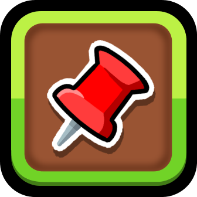

 <h1> Level Pins!</h1> 

A lil mod that allows you to **pin** any amount of levels at the top of your created levels! 

just click the toggle in a level's menu to pin it!!
##### pro tip: "move to top" also reorders ur pinned levels :D
---
## Contact
Please report issues on the GitHub, or just contact me on one of the socials on my website <cl>(discord/twitter prefered)

---
## Credits
Special thanks to Cvolton for the [Editor Level ID API](https://github.com/Cvolton/level-id-api-geode) & to [squintted](https://x.com/squintted) for the mod idea!!!